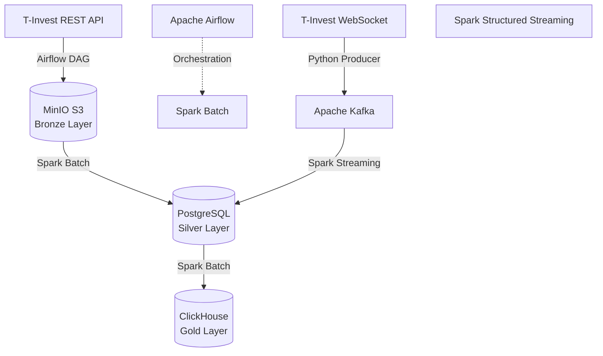

# tinvest-flow

**Hybrid Data Platform & DWH на базе T-Invest API**

[](https://github.com/Mifestos/tinvest-flow/actions/workflows/ci.yml)
[](https://github.com/Mifestos/tinvest-flow/actions/workflows/cd.yml)
[](https://www.python.org/)
[](https://www.docker.com/)

Платформа обработки данных, реализующая гибридную (Lambda/Kappa) архитектуру на базе медальонного слоения (Bronze -> Silver -> Gold). Проект демонстрирует end-to-end пайплайны: от сбора сырых данных из публичного API Т-Инвестиций до построения аналитических витрин в MPP-СУБД.

## Архитектура

Платформа разделена на два независимых контура:

1. **Batch Pipeline (исторические данные):** 
   `T-Invest REST API` -> `Apache Airflow` -> `MinIO (S3)` -> `Apache Spark (Batch)` -> `PostgreSQL` -> `ClickHouse`.
2. **Streaming Pipeline (real-time данные):** 
   `T-Invest WebSocket` -> `Python Producer` -> `Apache Kafka` -> `Apache Spark (Structured Streaming)` -> `PostgreSQL`.


## Технологический стек
### Языки и библиотеки:

* Python 3.10+ (PySpark, Pydantic, psycopg2, boto3, aiokafka)

* SQL (PostgreSQL, ClickHouse)

### Обработка данных и инфраструктура:

* Оркестрация: Apache Airflow (CeleryExecutor)

* Потоковая обработка: Apache Spark Structured Streaming

* Пакетная обработка: Apache Spark (Batch)

* Брокер сообщений: Apache Kafka (KRaft mode)

* Data Lake: MinIO (S3-совместимое хранилище)

* Реляционная БД (DWH): PostgreSQL

* Аналитическая БД (Витрины): ClickHouse

### DevOps и качество кода:

* Контейнеризация: Docker, Docker Compose (Multi-stage builds)

* CI/CD: GitHub Actions (Lint, Type-check, Tests, Publish Docker Images)

* Линтеры и типизация: Ruff, Mypy (strict mode)

* Тестирование: Pytest

## Ключевые инженерные решения (ADR)
* Идемпотентность Batch-слоя: В Airflow DAG-ах используется параметр data_interval_start для партиционирования данных в S3. Запись в PostgreSQL выполняется через INSERT ... ON CONFLICT DO UPDATE. Это гарантирует, что повторный запуск DAG-а (backfill) не создаст дубликатов.

* Паттерн JDBC UPSERT в Spark Streaming: Стандартный Spark JDBC не поддерживает нативные UPSERT (MERGE). Для обхода этого ограничения реализован паттерн: Spark параллельно пишет микробатч в промежуточную staging-таблицу, после чего выполняется быстрый нативный SQL-запрос слияния данных (INSERT INTO target SELECT ... ON CONFLICT). Это избавляет от сбора данных на драйвере (collect()).

* Изоляция окружений: Используются кастомные Docker-образы (Dockerfile.airflow на Python 3.12, Dockerfile.spark на Python 3.10), что исключает конфликты зависимостей между оркестратором и вычислительным кластером.

* Масштабируемость Spark: Кластер Spark развернут в конфигурации Master-Worker. Архитектура позволяет горизонтально масштабировать вычислительные мощности (добавляя контейнеры spark-worker) без изменения кода.

## Структура репозитория
```text
├── src/tinvest_flow/      # Исходный код (src-layout)
│   ├── common/            # Инфраструктурные утилиты (S3, logging)
│   ├── config.py          # Валидация конфигурации (Pydantic Settings)
│   ├── ingestion/         # Модули сбора данных (REST, WebSocket)
│   └── processing/        # Задания Spark (Batch, Streaming)
├── dags/                  # DAG-файлы Airflow (только оркестрация, без бизнес-логики)
├── infra/                 # DDL-скрипты инициализации PostgreSQL и ClickHouse
├── tests/                 # Pytest (Unit-тесты)
├── docker-compose.yml     # Описание локальной инфраструктуры
└── pyproject.toml         # Управление зависимостями и настройки линтеров
```
## Развертывание (Local Development)
### Требования
* Docker и Docker Compose
* Токен песочницы T-Invest API и ID виртуального счета

### Запуск инфраструктуры
1. Настройте переменные окружения:

```bash
cp .env.example .env
# Заполните TINKOFF_SANDBOX_TOKEN и TINKOFF_SANDBOX_ACCOUNT_ID
```
2. Запустите стек (сборка кастомных образов занимает несколько минут):

```bash
docker compose up -d --build
```
3. Настройте Connections в Airflow (http://localhost:8081):

* dwh_postgres: Type=Postgres, Host=postgres_dwh, DB=dwh, Login=dwh, Password=dwh, Port=5432.

* aws_default: Type=AWS, Login=minioadmin, Password=minioadmin, Extra={"endpoint_url": "http://minio:9000"}.

### Запуск Batch-пайплайна
В веб-интерфейсе Airflow последовательно активируйте и запустите DAGs:

1. batch_ingest_candles (Сбор исторических данных)

2. bronze_to_silver_candles (Загрузка в PostgreSQL)

3. silver_to_gold_marts (Агрегация в ClickHouse)

### Запуск Streaming-пайплайна
Запустите продюсера (слушает WebSocket и пишет в Kafka):

```bash
docker compose exec airflow-worker python -m tinvest_flow.ingestion.trades_producer
```
В отдельном терминале запустите Spark-джобу (читает Kafka, пишет в PostgreSQL):

```bash
docker compose exec spark-master /opt/spark/bin/spark-submit \
  --master spark://spark-master:7077 \
  --packages org.postgresql:postgresql:42.7.1,org.apache.spark:spark-sql-kafka-0-10_2.12:3.5.1 \
  --conf spark.jars.ivy=/tmp/.ivy \
  /opt/spark-apps/src/tinvest_flow/processing/stream_trades_to_silver.py
```
## Контроль качества и CI/CD
* Статический анализ: ruff (линтер) и mypy (строгая проверка типов, strict = true).

* Тестирование: pytest с изоляцией переменных окружения через фикстуры.

* Pre-commit: Хуки для автоматического форматирования перед коммитом.

* CI: GitHub Actions проверяет типы, стиль кода и прогоняет тесты при каждом PR.

* CD: GitHub Actions собирает multi-platform Docker-образы (linux/amd64, linux/arm64) и публикует их в GitHub Container Registry.

## Автор

**Mifestos** 
- GitHub: [@Mifestos](https://github.com/Mifestos)

## Лицензия

Этот проект распространяется под лицензией MIT. Подробности смотрите в файле [LICENSE](LICENSE).