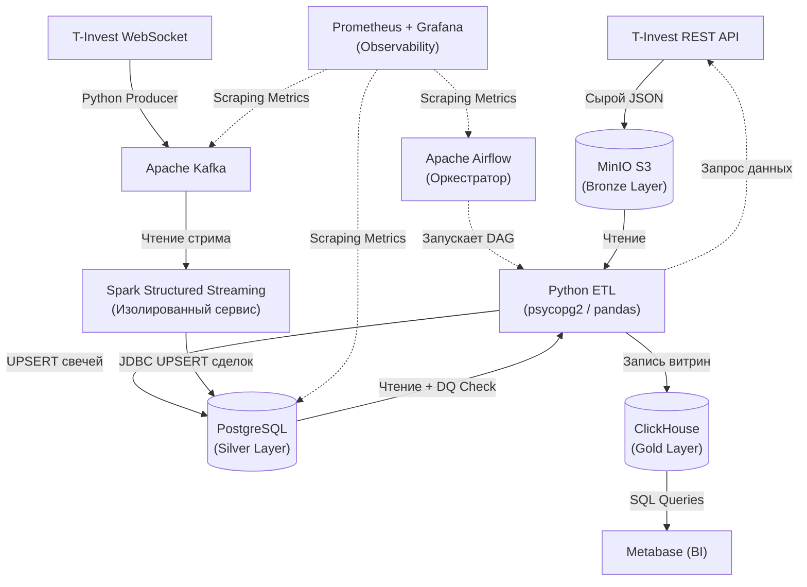
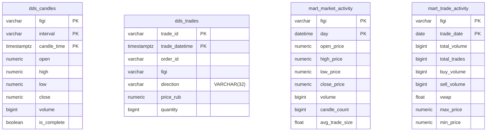
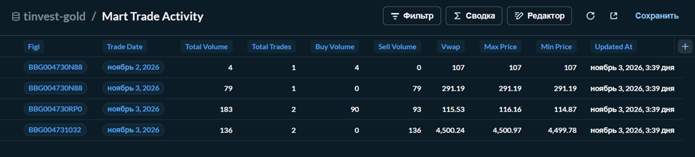
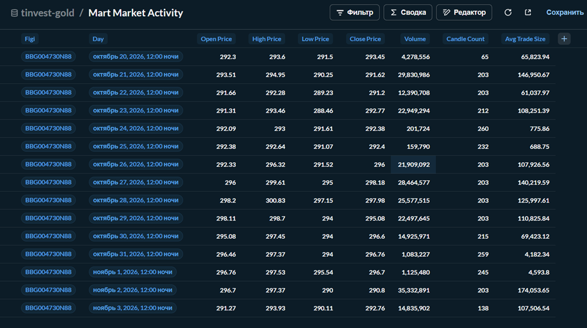

# tinvest-flow

**Hybrid Data Platform & DWH на базе T-Invest API**

[](https://github.com/Mifestos/tinvest-flow/actions/workflows/ci.yml)
[](https://github.com/Mifestos/tinvest-flow/actions/workflows/cd.yml)
[](https://www.python.org/)
[](https://www.docker.com/)

Платформа обработки данных, реализующая гибридную (Lambda) архитектуру с разделением на слои хранения (Bronze -> Silver -> Gold). Проект демонстрирует end-to-end пайплайны: от сбора сырых данных из публичного API Т-Инвестиций до построения аналитических витрин в MPP-СУБД, с полным покрытием Data Quality проверками и мониторингом.

## Точки доступа (Localhost Endpoints)

После запуска `docker compose up -d` все сервисы доступны локально по следующим адресам:

| Сервис | URL / Порт | Назначение | Учетные данные (по умолчанию) |
| :--- | :--- | :--- | :--- |
| **Apache Airflow** | [http://localhost:8081](http://localhost:8081) | UI оркестратора, логи DAG-ов | `airflow` / `airflow` |
| **Spark Master UI** | [http://localhost:8082](http://localhost:8082) | Мониторинг Spark-кластера и стриминга | - |
| **MinIO Console** | [http://localhost:9001](http://localhost:9001) | S3-хранилище (Bronze Layer) | `minioadmin` / `minioadmin` |
| **ClickHouse** | [http://localhost:8123/play](http://localhost:8123/play) | HTTP-интерфейс и SQL Playground (Gold Layer) | `default` / *(пусто)* |
| **Metabase** | [http://localhost:3000](http://localhost:3000) | BI-дашборды поверх ClickHouse | Настраивается при первом входе |
| **Prometheus** | [http://localhost:9090](http://localhost:9090) | Сбор и визуализация метрик (Targets) | - |
| **Grafana** | [http://localhost:3001](http://localhost:3001) | Дашборды мониторинга пайплайна | `admin` / `admin` |

## Архитектура

Платформа разделена на два независимых контура обработки данных (Batch и Streaming), а также контур Observability.


## Схема данных (Data Model)

## Технологический стек
### Обработка данных и Инфраструктура:
* Оркестрация: Apache Airflow (CeleryExecutor)

* Потоковая обработка: Apache Spark Structured Streaming (вынесен в отдельный контейнер)

* Пакетная обработка: Python (Airflow PythonOperator, Pandas, psycopg2)

* Брокер сообщений: Apache Kafka (KRaft mode)

* Data Lake: MinIO (S3-совместимое хранилище)

* Реляционная БД (DWH): PostgreSQL (партиционирование, серверные курсоры)

* Аналитическая БД (Витрины): ClickHouse (ReplacingMergeTree)

### DataOps, Quality & Observability:
* Миграции БД: Alembic (PostgreSQL) + кастомный SQL-runner (ClickHouse)

* Data Quality: Great Expectations (проверки на null, диапазоны, уникальность)

* Мониторинг: Prometheus, Grafana, StatsD Exporter, Postgres/Kafka Exporters

* CI/CD: GitHub Actions (Lint, Type-check, Pytest, Alembic Dry-run, Docker Build/Push)

* Линтеры и типизация: Ruff, Mypy (strict mode)

## Структура репозитория
```text
├── src/tinvest_flow/      # Исходный код (src-layout)
│   ├── common/            # Инфраструктурные утилиты (S3, миграции, DQ)
│   ├── config.py          # Валидация конфигурации (Pydantic Settings)
│   ├── ingestion/         # Сбор данных (REST API, WebSocket, Kafka Producer)
│   └── processing/        # ETL (Batch), Spark Streaming, миграции
├── dags/                  # DAG-файлы Airflow (batch_ingest, dq_check, migrations)
├── migrations/            # Alembic (Postgres) и SQL-скрипты (ClickHouse)
├── infra/                 # Конфигурации Prometheus, Grafana, StatsD
├── demo/                  # Симулятор сделок для тестирования Streaming-контура
├── tests/                 # Pytest (Unit-тесты с моками внешних сервисов)
├── docker-compose.yml     # Описание локальной инфраструктуры (18 сервисов)
└── pyproject.toml         # Управление зависимостями и настройки линтеров
```
## Развертывание (Local Development)
### Требования
* Docker и Docker Compose (рекомендуется выделить не менее 8 ГБ RAM для WSL2/Docker Desktop).

* Токен песочницы T-Invest API и ID виртуального счета.
### Запуск инфраструктуры
1. Настройте переменные окружения

```bash
cp .env.example .env
# Заполните TINKOFF_SANDBOX_TOKEN и TINKOFF_SANDBOX_ACCOUNT_ID
```
2. Запустите стек (сборка кастомных образов занимает несколько минут):

```bash
docker compose up -d --build
```

### Запуск Batch-пайплайна
DAG-и связаны через TriggerDagRunOperator. Достаточно запустить первый DAG, остальные выполнятся автоматически.

1. В веб-интерфейсе Airflow запустите DAG batch_ingest_candles (Сбор исторических данных).

2. Он автоматически инициирует db_migrations (применение схемы Alembic), затем bronze_to_silver_candles (загрузка в PostgreSQL).

3. ЗУправление перейдет к silver_to_gold_marts (агрегация в ClickHouse с предварительным шагом dq_check_candles от Great Expectations).
### Запуск Streaming-пайплайна
Контур потоковой обработки изолирован от оркестратора Airflow. Spark Streaming работает как независимый долгоживущий сервис.

Запустите Spark-джобу (она читает Kafka, пишет в PostgreSQL и перезапускается при сбоях):

```bash
docker compose up -d spark-streaming
```
Для отправки тестовых данных используйте встроенный симулятор сделок:

```bash
docker compose up -d trade-simulator
```
## Контроль качества и CI/CD
* Тестирование: pytest (покрытие > 50% критической логики). Внешние сервисы (Kafka, Spark, S3) изолированы с помощью unittest.mock.

* Data Quality: Проверки Great Expectations встроены в DAG-и. Если данные не проходят валидацию, DAG падает и не пропускает «грязные» данные в слой Gold.

* CI (GitHub Actions): При пуше/PR проверяется типизация (mypy), стиль (ruff), прогоняются тесты (pytest), валидируются миграции Alembic в режиме dry-run и собираются Docker-образы.

* CD (GitHub Actions): При пуше в main собираются multi-platform образы (linux/amd64, linux/arm64), публикуются в GHCR и имитируется шаг деплоя.
## Интеграция с BI (Metabase)
Metabase подключен к слою Gold (ClickHouse). Примеры витрин (Daily OHLCV по свечам и агрегация по сделкам с расчетом VWAP):




## Ключевые инженерные решения (ADR)
* ADR-001: Паттерн JDBC UPSERT в Spark Streaming.
Стандартный Spark JDBC не поддерживает UPSERT. Данные пишутся в staging-таблицу, после чего выполняется нативный SQL INSERT ... ON CONFLICT DO UPDATE. Для предотвращения ошибок при дубликатах применяется dropDuplicates.

* ADR-002: Dead Letter Queue (DLQ).
В Spark добавлен режим PERMISSIVE. Сообщения с нарушенной схемой перехватываются в _corrupt_record и отправляются в топик raw_trades_dlq, не останавливая пайплайн.

* ADR-003: Партиционирование PostgreSQL.
Таблицы dds_trades и dds_candles партиционированы по времени (RANGE). DAG manage_partitions ежедневно создает партиции на 3 месяца вперед. DEFAULT-партиции не используются.

* ADR-004: Развязка Spark Streaming.
Spark Streaming работает как независимый сервис в Docker (restart: always). Это предотвращает блокировку слотов Airflow и решает проблему отсутствия поддержки deploy-mode: cluster для Python в Standalone-кластере.

* ADR-005: Чанковая агрегация в ClickHouse.
Чтение из PostgreSQL идет через серверный курсор (RealDictCursor). Таблица в ClickHouse очищается (TRUNCATE) перед полной перезаписью для идемпотентности и защиты от OOM.

* ADR-006: Оконная пагинация.
Из-за лимитов T-Invest API метод fetch_candles разбивает запрошенный период на временные окна (в зависимости от интервала).

* ADR-007: Schema Migrations.
Для PostgreSQL используется Alembic. Для ClickHouse реализован SQL-first runner с таблицей учета версий (schema_migrations), что решает проблему небезопасных ALTER TABLE в колоночных СУБД.

* ADR-008: Data Quality Gates.
В DAG-и встроен шаг dq_check (Great Expectations), который блокирует попадание «грязных» данных в слой Gold.

* ADR-009: Observability.
Prometheus + Grafana собирают метрики из Airflow (через StatsD), PostgreSQL и Kafka. Настроены дашборды для мониторинга health-check сервисов.
## Автор

**Mifestos** 
- GitHub: [@Mifestos](https://github.com/Mifestos)

## Лицензия

Этот проект распространяется под лицензией MIT. Подробности смотрите в файле [LICENSE](LICENSE).