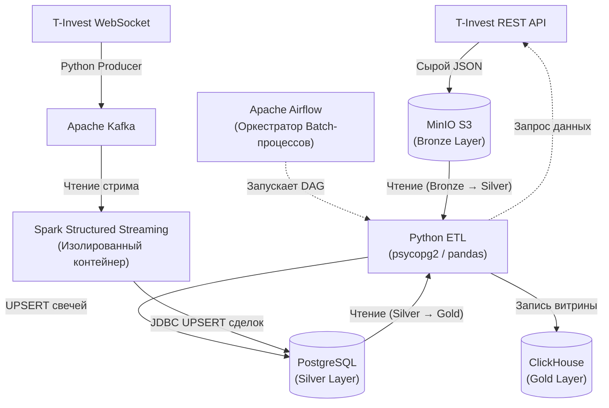
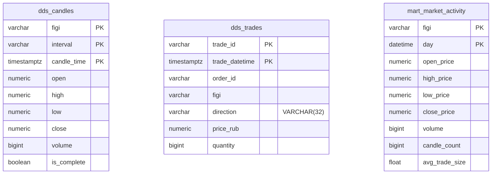
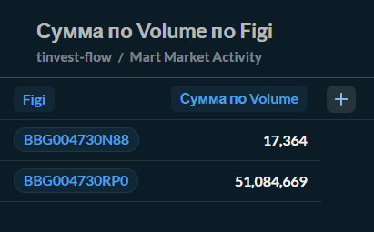

# tinvest-flow

**Hybrid Data Platform & DWH на базе T-Invest API**

[](https://github.com/Mifestos/tinvest-flow/actions/workflows/ci.yml)
[](https://github.com/Mifestos/tinvest-flow/actions/workflows/cd.yml)
[](https://www.python.org/)
[](https://www.docker.com/)

Платформа обработки данных, реализующая гибридную (Lambda) архитектуру с разделением на слои хранения (Bronze -> Silver -> Gold). Проект демонстрирует end-to-end пайплайны: от сбора сырых данных из публичного API Т-Инвестиций до построения аналитических витрин в MPP-СУБД.

## Архитектура

Платформа разделена на два независимых контура обработки данных:

1. **Batch Pipeline (исторические данные):**
   `T-Invest REST API` -> `Apache Airflow` -> `MinIO (S3)` -> `Python/psycopg2` -> `PostgreSQL (DDS)` -> `ClickHouse (Data Mart)`.
2. **Streaming Pipeline (real-time данные):**
   `T-Invest WebSocket` -> `Python Producer` -> `Apache Kafka` -> `Spark Structured Streaming` -> `PostgreSQL (DDS)`.


## Схема данных (Data Model)

## Технологический стек
### Языки и библиотеки:
* Python 3.12+ (PySpark, Pydantic, psycopg2, boto3, aiokafka)

* SQL (PostgreSQL, ClickHouse)
### Обработка данных и инфраструктура:
* Оркестрация: Apache Airflow (CeleryExecutor)

* Потоковая обработка: Apache Spark Structured Streaming (изолированный сервис)

* Пакетная обработка: Python (Airflow PythonOperator)

* Брокер сообщений: Apache Kafka (KRaft mode)

* Data Lake: MinIO (S3-совместимое хранилище)

* Реляционная БД (DWH): PostgreSQL (с партиционированием по времени)

* Аналитическая БД (Витрины): ClickHouse
### DevOps и качество кода:
* Контейнеризация: Docker, Docker Compose

* CI/CD: GitHub Actions (Lint, Type-check, Tests, Publish Docker Images)

* Линтеры и типизация: Ruff, Mypy (strict mode)

* Тестирование: Pytest
## Структура репозитория
```text
├── src/tinvest_flow/      # Исходный код (src-layout)
│   ├── common/            # Инфраструктурные утилиты (S3, logging)
│   ├── config.py          # Валидация конфигурации (Pydantic Settings)
│   ├── ingestion/         # Модули сбора данных (REST, WebSocket, Producer)
│   └── processing/        # Batch ETL и Spark Streaming джобы
├── dags/                  # DAG-файлы Airflow (оркестрация)
├── infra/                 # DDL-скрипты инициализации PostgreSQL и ClickHouse
├── tests/                 # Pytest (Unit-тесты)
├── docker-compose.yml     # Описание локальной инфраструктуры
└── pyproject.toml         # Управление зависимостями и настройки линтеров
```
## Развертывание (Local Development)
### Требования
* Docker и Docker Compose (рекомендуется выделить не менее 8 ГБ RAM для WSL2/Docker Desktop).

* Токен песочницы T-Invest API и ID виртуального счета.
### Запуск инфраструктуры
1. Настройте переменные окружения

```bash
cp .env.example .env
# Заполните TINKOFF_SANDBOX_TOKEN и TINKOFF_SANDBOX_ACCOUNT_ID
```
2. Запустите стек (сборка кастомных образов занимает несколько минут):

```bash
docker compose up -d --build
```
3. Настройте Connections в Airflow (http://localhost:8081):

* dwh_postgres: Type=Postgres, Host=postgres_dwh, DB=dwh, Login=dwh, Password=dwh, Port=5432.

* aws_default: Type=AWS, Login=minioadmin, Password=minioadmin, Extra={"endpoint_url": "http://minio:9000"}.
### Запуск Batch-пайплайна
DAG-и связаны через TriggerDagRunOperator. Достаточно запустить первый DAG, остальные выполнятся автоматически.

1. В веб-интерфейсе Airflow запустите DAG batch_ingest_candles (Сбор исторических данных).

2. Он автоматически инициирует bronze_to_silver_candles (Загрузка в PostgreSQL).

3. Затем данные попадут в silver_to_gold_marts (Агрегация в ClickHouse).
### Запуск Streaming-пайплайна
Контур потоковой обработки изолирован от оркестратора Airflow. Spark Streaming работает как независимый долгоживущий сервис.

Запустите Spark-джобу (она читает Kafka, пишет в PostgreSQL и перезапускается при сбоях):

```bash
docker compose up -d spark-streaming
```
Для отправки тестовых данных используйте встроенный симулятор сделок:

```bash
docker compose up -d trade-simulator
```
## Контроль качества и CI/CD
* Статический анализ: ruff (линтер) и mypy (строгая проверка типов, strict = true).

* Тестирование: pytest с изоляцией переменных окружения через фикстуры.

* Pre-commit: Хуки для автоматического форматирования перед коммитом.

* CI: GitHub Actions проверяет типы, стиль кода и прогоняет тесты при каждом PR.

* CD: GitHub Actions собирает multi-platform Docker-образы (linux/amd64, linux/arm64) и публикует их в GitHub Container Registry.
## Интеграция с BI (Metabase)
Для демонстрации конечного потребления данных в проект интегрирован Metabase. Он подключается напрямую к слою Gold (ClickHouse), позволяя аналитикам строить отчеты без написания SQL-запросов. Пример агрегированного запроса по витрине mart_market_activity доступен в папке docs/images/.

Пример агрегированного запроса по витрине `mart_market_activity`: суммарный объем торгов (`volume`) в разрезе финансовых инструментов (`figi`).


## Ключевые инженерные решения (ADR)
* ADR-001: Паттерн JDBC UPSERT в Spark Streaming с защитой от дубликатов.
Стандартный Spark JDBC не поддерживает UPSERT. Данные батча пишутся в уникальную staging-таблицу (stg_trades_{batch_id}), после чего выполняется нативный SQL-запрос (INSERT ... ON CONFLICT DO UPDATE). Для предотвращения ошибки CardinalityViolation при дублирующихся сообщениях в Kafka применяется dropDuplicates(["trade_id", "trade_datetime"]) в DataFrame перед вставкой.

* ADR-002: Dead Letter Queue (DLQ) для потоковых данных.
В Spark Structured Streaming добавлен режим PERMISSIVE. Сообщения с нарушенной схемой (invalid JSON) перехватываются в поле _corrupt_record и отправляются в отдельный Kafka-топик (raw_trades_dlq) для последующего анализа, не нарушая работу основного пайплайна.

* ADR-003: Управление партиционированием в PostgreSQL.
Таблицы dds_trades и dds_candles партиционированы по времени (RANGE). Для предотвращения падений при поступлении данных за периоды, на которые еще нет партиций, реализован DAG manage_partitions, который ежедневно проверяет и создает партиции на 3 месяца вперед. DEFAULT-партиции не используются.

* ADR-004: Гибридная Lambda архитектура и развязка Spark Streaming.
Spark Streaming работает как независимый сервис в Docker (restart: always). Это предотвращает блокировку слотов Airflow и решает проблему ограничений Standalone-кластера Spark (отсутствие поддержки deploy-mode: cluster для Python-приложений).

* ADR-005: Чанковая агрегация в ClickHouse (защита от OOM).
При построении витрин используется потоковое чтение из PostgreSQL через серверный курсор (RealDictCursor, itersize=100_000). Таблица в ClickHouse очищается (TRUNCATE) перед полной перезаписью для обеспечения идемпотентности. Это предотвращает выгрузку всей таблицы в RAM и дублирование данных при перезапусках.

* ADR-006: Оконная пагинация при загрузке исторических данных.
В связи с лимитами T-Invest API на количество возвращаемых свечей, метод fetch_candles разбивает запрошенный период на временные окна (в зависимости от интервала), что гарантирует загрузку полного объема исторических данных без потерь.
## Автор

**Mifestos** 
- GitHub: [@Mifestos](https://github.com/Mifestos)

## Лицензия

Этот проект распространяется под лицензией MIT. Подробности смотрите в файле [LICENSE](LICENSE).